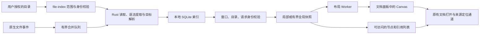

# 知识图谱：实现、数据规则与验证

本功能在现有文档面板中展示当前文件夹的文档关系。正文是关系的唯一来源；图谱不改写文稿，不给文稿插入 ID，也不推断不存在的语义关系。编辑器 iframe、源码镜像、历史和输入法链路继续由原有编辑器管理。

## 使用方式

打开文件夹后，点击右上角 AI 旁边的知识图谱图标，或使用“显示 → 知识图谱”、`Cmd/Ctrl+Alt+G`。当前文档在目录内时默认显示局部一跳关系，也可以切换两跳或全目录。

- 单击节点查看入链、出链及各次引用；双击、Enter 或“打开文档”进入正文。引用可以定位原文，锚点存在时可以定位目标标题或块。
- 拖动节点时，最多 150 个直接关联节点参与局部布局；其他节点保持位置。支持固定/取消固定、定位、适合视图、鼠标位置缩放、背景平移、方向键平移和节点操作菜单。
- 支持标题/路径搜索、目录与 YAML 标签筛选、未解析目标、孤立文档开关。中文输入法组合期间不发送半成品查询。
- 文字节点列表和引用列表分页，提供图形之外的键盘访问路径。关系详情在选中节点后展开，可收起；宽屏可拖动分隔柄调整宽度，也支持方向键与 Home/End，当前窗口会记住宽度。窄面板将关系详情放到图谱下方，内容可独立滚动。
- 明暗主题跟随应用与自定义主题的背景、正文、焦点色。缺失目标以空心节点区别；选中关系显示方向。可选方向动效只在选中节点时短暂播放，最多 8 条路径、450 ms；系统减少动态效果设置实时生效。
- 视图位置、固定状态、相机、筛选和动效设置自动保存；支持原生文件对话框导入/导出 JSON。重置视图恢复筛选、相机和动效，保留已安排的节点位置与固定状态。

关闭图谱返回原编辑器。图谱覆盖正文时，编辑菜单、兼容菜单和已经排队的旧命令不能继续修改被遮住的正文；切换文档会退出图谱。未保存修改有明确提示，关系索引反映磁盘上最近保存的内容。

## 技术决策

| 问题 | 采用的实现 | 依据与取舍 |
| --- | --- | --- |
| 关系保存在哪里 | Markdown 保存关系事实；宿主本地数据目录保存可重建 SQLite 索引 | 不污染用户文件夹，不把可推导数据库放进 Git/同步盘，不要求目录可写。跨设备携带正文即可重建关系。 |
| 索引数据库 | Rust + `rusqlite 0.41.0` bundled SQLite + WAL | 单写者、短事务、并行读取；不增加数据库服务。WAL 的共享内存要求也支持把索引留在设备本地，而不是网络共享目录。参见 [SQLite WAL](https://sqlite.org/wal.html)。 |
| Markdown 提取 | `pulldown-cmark 0.13.5` 的语法事件和源码偏移 | 不用正则全局扫链接；代码、图片、数学和元数据边界来自语法解析。源码偏移接口依据[官方项目说明](https://github.com/pulldown-cmark/pulldown-cmark)，具体版本以本仓库锁文件和已执行回归为准。 |
| 布局 | 独立 Worker 内 `d3-force 3.0.0`，手动分批 tick、收敛即停 | 主线程只处理交互与绘制。D3 官方明确支持停止自动计时后手动 tick，并建议大型静态布局使用 Worker：[Force simulations](https://d3js.org/d3-force/simulation)。 |
| 绘制 | 自有单层不透明 Canvas 2D、缓存 Path2D、局部移动几何 | 控制绘制与内存成本，面向当前最多 5,000 可见节点的场景，不引入额外图形库。 |
| 数据跨线程 | 有界消息、批量坐标、可转移 Float32Array、epoch/serial 校验 | 旧布局结果不能覆盖新图；React 不参与逐帧更新。参考 [Web Workers](https://developer.mozilla.org/en-US/docs/Web/API/Web_Workers_API/Using_web_workers)。 |
| 交互范围 | 文档、真实引用、局部/全局、缺失/歧义及来源定位 | 参考 [Obsidian Graph view](https://obsidian.md/help/plugins/graph) 的使用问题，不复制其外观、数据格式或全部扩展语义。没有加入 AI 推断边、标签节点、粒子背景、3D 或永不停歇的物理模拟。 |

图谱 UI 和 Worker 按需加载。普通启动只注册空宿主状态；没有打开图谱就不会启动文件扫描、SQLite 连接、布局 Worker 或图谱帧循环。

关系面板复用 `DocumentDetailsResize` 的 pointer capture、rAF 和 CSS 变量更新方式。拖动期间不逐帧提交 React 宽度状态，不重新设置图谱数据，也不重建画布或编辑器。键盘焦点保留在具体控件上；文档列表获得焦点时，Enter 只展开或收起列表，不误打开选中的图谱文档。



## 存储与关系维护

索引路径为平台 `local_data_dir()` 下的 `marklyra/knowledge/workspaces/<目录身份 SHA-256>/index.sqlite`；开发运行（debug 构建）使用独立的 `marklyra-dev` 根目录。同目录的 `views.json` 保存视图。目录身份来自已有 `DirectoryBookmark.identity`，不是渲染层传入的任意路径。目录移动后核对真实绑定；索引根路径变化会重新提取，避免绝对文件链接继续沿用旧解析。

数据库保存 `notes`、逐次引用 `refs`、解析依赖 `dependencies`、按来源/目标聚合的 `edges` 和版本 `meta`。重复引用保留各自源码位置，显示边合并计数。反向索引支持入链和两跳查询。查询在 SQLite 读事务中取得一致快照；128 篇文档一批发布，未提交的半批数据不可见。

文档自身的锚点引用保留在来源记录中，不绘制文档自环。初次索引逐批显示进度，未完成时不把当前子集当成完整目录。

普通增量流程为：文件事件合并 → 校验真实文件身份 → 内容摘要比较 → 只解析变化的文档 → 根据路径、规范化路径、短名与别名依赖找出受影响来源 → 重新解析这些来源的目标 → 提交并增加代次。增加同名文档或别名时，原本唯一的双链可能变为歧义；删除或重命名目标时，旧引用变为缺失，不自动改写正文或猜测新目标。

重新打开先比较文件标记；事件丢失或队列溢出时进行内容校验扫描，内容不变不会重新提取关系。显式“重建索引”和提取器版本升级才清空派生摘要并重新提取。数据库损坏时把旧数据库及伴随文件隔离保留，再重建。单个文件读取/解析失败会保留旧记录并标为过期，不把错误当成成功或静默删掉引用。

视图文件与关系索引独立，写入使用同目录临时文件、同步和原子替换。读取失败保留原文件并停止覆盖，用户可通过明确重置或导入恢复。导入/保存/导出统一限制 1 MiB；位置必须有限，相机比例限定在实际缩放范围。文件夹关闭或窗口销毁撤销对应会话，旧异步打开请求不能重新附着到已关闭或替换的目录。同目录多窗口共享索引，只有仍然激活的窗口需要计算时才继续工作。

关闭图谱后暂停索引并释放绘制与布局资源；少量暂停的索引服务保留以加速再次打开，最多缓存 8 个目录。暂停期间只保留有界事件提示；再次打开校验目录变化。页面隐藏时暂停索引、轮询、布局、动画。监听器不可用时，激活状态每 30 秒进行一次元数据校验，并显示降级状态。

## 解析规则与边界

| 输入 | 行为 |
| --- | --- |
| `[文字](../Note.md#标题)`、引用式 Markdown 链接 | 按来源目录解析相对路径；查询部分与片段分离；百分号转义只解码一次。 |
| `[[Note]]`、`[[folder/Note\|显示]]` | 优先来源目录中的精确路径和 `.md`，其次目录根路径；没有目录的短名再查文件名/完整文件名/声明别名。唯一才连接；同名返回歧义候选，不任取第一个。 |
| YAML `title`、`aliases`/`alias`、`tags` | 提供标题、别名与筛选元数据。其他字段不生成关系。忽略字段中的 YAML 别名树不进行无界展开；不读取行内 `#tag` 作为标签。 |
| 标题与行尾 `^block-id` | 保存目标锚点及源码位置；重复标题有带序号的规范化锚点。目标文档存在但锚点不存在时，边仍指向文档并报告锚点缺失。 |
| 代码块、行内代码、数学、图片和嵌入语法、裸 HTML 属性 | 不推导文档边。本版不承诺完整 Obsidian 语法/插件兼容，也不新增编辑器内双链补全或嵌入渲染。 |
| http/https/mailto | 标记外部引用，不进入文档图。 |
| 当前根目录内、根路径匹配的绝对路径或 `file:` URL | 转为范围内目标后继续核对。根外路径、路径穿越、符号链接、隐藏项及 `node_modules` 不扩张授权。 |
| 大小写与 Unicode 等价 | 精确拼写优先；路径等价通过实际文件句柄身份证明，不能在区分大小写的文件系统中随意合并两个文件。双链短名/别名使用规范化名称匹配并保留歧义。 |

导航记录 UTF-16 行列、精确片段和完整源码指纹，继续使用现有文档服务的过期结果保护。行号索引和每约 256 字节一个 UTF-16 检查点避免长行中每条链接都重扫前缀；行尾直接从行索引取得。BOM、UTF-8/UTF-16、混合换行均只读处理，图谱不创建文档编辑会话。

尚未解析的内部引用仍属于连接关系，不把只有缺失目标的来源文档误判为孤立。缺失节点按来源与目标文字区分，避免把不同目录里的同名相对路径误合并。所有引用仍可在关系详情中分页检查。

## 资源预算

这些是实现上限，不是对所有上限组合的性能承诺。

| 层级 | 预算与降级 |
| --- | --- |
| 扫描 | 100,000 篇文档、500,000 个目录项、深度 64；达到限制或无法读取时报告不完整。 |
| 单文档 | 8 MiB、20,000 次引用、20,000 个锚点；YAML 32 KiB，标签/别名列表分别最多 128 项。超限记录明确错误。 |
| 调度 | 一个索引写线程；64 批消息，合并窗口 180 ms；待处理路径超过 4,096 转校验扫描；扫描约每工作 8 ms 让出 16 ms。忽略目录的事件先过滤。 |
| 查询 | 一跳/两跳；默认 2,000，最多 5,000 个可见节点、20,000 条可见边；最多检查 250,000 条候选边；每来源最多展示 500 个未解析目标。截断明确标记，原始引用仍保留。 |
| 布局 | 超过 1,000 节点时用最多 256 个临时布局组求初始位置，再展开真实节点；组不改变关系数据。拖动局部邻域最多 150。每计算批约 6 ms，间隔 24 ms，有迭代上限，收敛即停。 |
| 绘制 | 一个不透明 Canvas，DPR 上限 2，最多 160 个标签；静止没有 rAF 循环；平移不重建路径，拖动只重绘需要变化的几何。 |
| 视图 | 最多保留 5,000 个位置/固定节点；缓存优先保留固定和当前可见节点。超过 JSON 字节预算时报告保存失败，保留此前文件。 |

## 验证与复现

性能和界面证据位于忽略目录 `artifacts/knowledge-graph/`，不进入 Git；产品代码、回归用例与复现工具进入版本管理。

```sh
pnpm check
cargo test --workspace --lib -- --test-threads=1
cargo test -p knowledge-index
cargo clippy -p knowledge-index -p file-index -p marklyra-desktop --all-targets -- -D warnings
pnpm exec playwright test -c playwright.desktop.config.ts tests/desktop-e2e/knowledge-graph.spec.ts tests/desktop-e2e/app.spec.ts tests/desktop-e2e/document-details.spec.ts --workers=2
node tools/performance/knowledge-native.mjs --release
pnpm build:desktop --no-bundle
```

原生工具只创建自有临时笔记目录和无持久配置的 WKWebView 窗口，不打开用户文稿、不复用已运行应用的数据。它采用产品相同的 IPC 隔离与编辑器协议：合成 10,000 篇文档/50,000 条关系，验证冷索引、真实文件事件增量、跨窗口拒绝、原生 SVG 按钮与点击路由、500/5,000 节点绘制、拖动、静止、20 次创建销毁，并与真实隔离编辑器共存。报告附代码 SHA-256、构建模式、操作系统、进程内存和逐次采样。

冷索引指全新 SQLite 数据库；合成文件刚刚写入，未清空操作系统文件缓存。编辑耗时记录插入命令及完整源码 `flush`，另记录随后两个绘制帧；不把它等同于物理键盘到屏幕的输入延迟。CPU 按占满一个逻辑核心为 100% 计算，静止阶段采用三个连续约 3 秒的窗口，保留每段原值并按完整约 9 秒计算均值；RSS 是明确采样点的进程驻留内存，不是所有时刻的严格峰值。原生夹具加载实际渲染器、Worker、索引命令和隔离编辑器；完整 Shell 的交互与命令路由另由浏览器回归验证。

性能基准同时检查源码、历史、权限和资源生命周期。当前原生夹具的目标包括绘制 P95 ≤ 6 ms、WebContent RSS 采样增量 ≤ 200 MiB、完整静止窗口 CPU 相对基线增量 ≤ 单核心 2 个百分点、单次增量后台工作 ≤ 100 ms、两跳查询 P95 ≤ 25 ms；交互帧间隔还需与空宿主基线比较。结果应记录设备、工作负载和输入身份，不将历史数字视为当前通过状态。

浏览器回归使用模拟 IPC，不能替代真实文件监听及宿主测试；原生夹具也不能替代 Windows WebView2 真机和系统输入法验收。GPU 共享进程没有可靠的独占归属，内存与 CPU 只报告被明确识别的宿主与 WebContent 进程。
