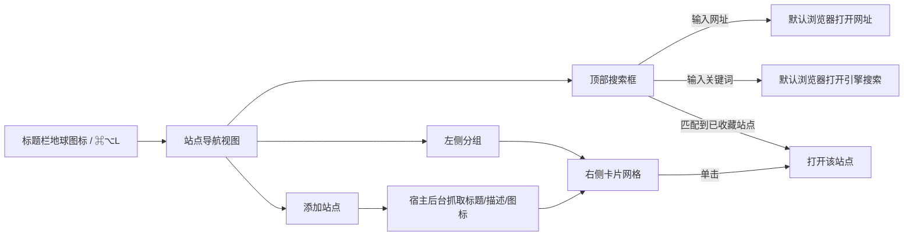
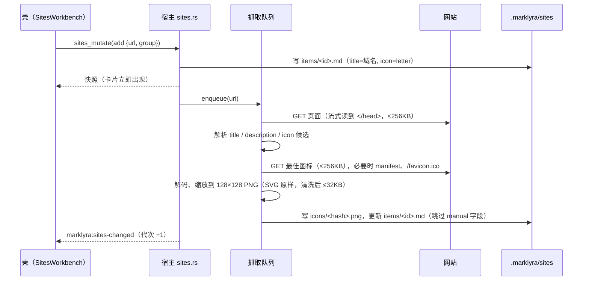
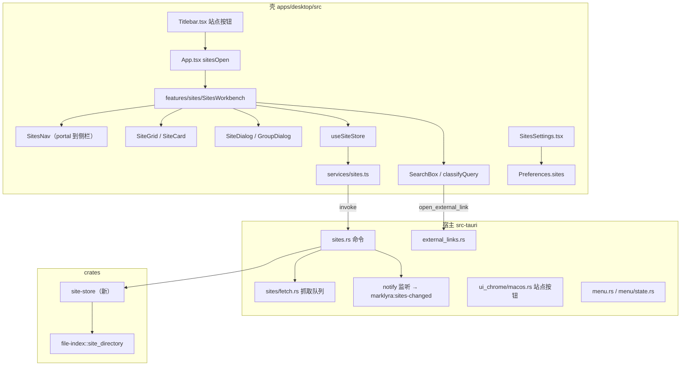

# 站点导航：设计与实施计划

> 状态：设计已确认（§2 的取舍按推荐方案定稿）。P0–P6 已实现，进度与偏差见 §12。高保真原型见 [prototypes/site-navigation.html](prototypes/site-navigation.html)（直接用浏览器打开，可切换明暗主题、分组、引擎，可试用搜索、添加站点、编辑分组等交互）。

站点导航是工作区里的一个"收藏网址"视图：标题栏右上角的地球图标打开它，主面板换成搜索框加站点卡片，左侧栏换成站点分组。数据存放在工作区的 `.marklyra/sites/`，与任务（`.marklyra/tasks/`）一样跟随文件夹，可以随 Git 同步到其他设备。

## 1. 结论先行

| 问题 | 决定 |
| --- | --- |
| 入口 | 标题栏右上角新增"站点导航"按钮，位于任务按钮左侧；菜单"显示 → 站点导航"，快捷键 `⌘⌥L` / `Ctrl+Alt+L`（现有 `⌘⌥G/T/N/S` 已占用，`L` 未占用，实现前在 `menu.rs` 复核） |
| 开关 | 设置页新增"站点导航"分区（排在"日历"之后），首项"在标题栏显示站点导航"，默认开启；关闭后按钮、菜单项、快捷键全部隐藏或禁用，数据不删除 |
| 视图模式 | 完全照搬任务视图：主面板替换为 `SitesWorkbench`，侧栏通过 portal 挂入 `.site-nav-host`，文件树保持挂载但隐藏，关闭后原样回来；与知识图谱、任务互斥；编辑器 `inert`，编辑命令经 `editorObscured` 拦截 |
| 未打开文件夹时 | 按钮可见但禁用，提示"站点导航（先打开文件夹）"，与任务、图谱一致 |
| 站点数据 | `.marklyra/sites/`：每个分组、每个站点一个 Markdown + YAML 文件（与 task-store 同构），图标为规范化后的 PNG/SVG 小文件；文件是唯一事实来源 |
| 抓取缓存 | 抓取状态（ETag、失败次数、下次重试时间）放设备本地数据目录，不写进工作区，避免 Git 抖动 |
| 元数据与图标抓取 | 自己实现，放在 Rust 宿主：`reqwest 0.12`（已有）取页面 `<head>`，`dom_query 0.28`（已有，export-service 在用）解析，`image 0.25`（已有）解码与缩放 |
| 搜索引擎 | 内置 Bing、Google，可加自定义模板（`https://…?q=%s`）；引擎是应用级偏好，不跟工作区走 |
| 打开方式 | 一律走现有 `open_external_link`（只允许无凭据的 http/https），由系统默认浏览器打开 |

## 2. 已确认的取舍

以下 5 点已于 2026-11-16 确认按推荐方案执行，实现时不再另行请示：

| # | 决定 |
| --- | --- |
| 1 | `reqwest` 打开 `charset` 特性（间接引入 `encoding_rs`），不另加直接依赖 |
| 2 | `image` 打开 `ico` 特性 |
| 3 | 第三方图标服务只作可选回退，默认关闭 |
| 4 | 引擎图标走站点抓取管线，安装包不内置品牌 logo，未取到时显示字母标 |
| 5 | 图标随工作区进 Git：单个 ≤ 32 KB、128×128、同域共享 |

各点的背景与理由：

1. **新增依赖 `encoding_rs`。** 不少中文站点仍是 GBK/GB2312 编码，当前依赖树里没有编码转换库（`reqwest` 以 `default-features = false` 引入，没有 `charset` 特性）。推荐：给 `reqwest` 打开 `charset` 特性（它会引入 `encoding_rs`），不另加直接依赖。不加的话，非 UTF-8 站点的标题会是乱码，只能退回用域名。
2. **`image` 打开 `ico` 特性。** 只是开特性，不新增 crate。大量站点只有 `/favicon.ico`，不开就解码不了。
3. **第三方图标服务默认关闭。** Google `s2/favicons`、DuckDuckGo `icons.duckduckgo.com` 能提高命中率，但会把你收藏的域名发给第三方，而且 Google 的服务在中国大陆不可直连。推荐只作为设置页里的可选回退，默认关闭。
4. **引擎图标。** Simple Icons（CC0）收录了 Google，但没有 Bing（实测 `simple-icons@13.21.0/icons/microsoftbing.svg` 返回 404）。另外 CC0 只覆盖 SVG 绘制本身，商标权仍属品牌方。推荐：引擎图标与普通站点用同一条抓取管线，首次使用时从引擎官网取 favicon 并缓存；拿到之前显示中性的字母标。不在安装包里内置任何品牌 logo。
5. **图标进 Git。** 图标随工作区同步是你的要求，代价是仓库里多出二进制小文件。设计上限制单个图标 ≤ 32 KB、统一 128×128，同一域名共享一个图标文件，500 个站点约 2–5 MB。如果你更在意仓库体积，可以改成图标只放设备本地缓存，工作区只存元数据。

## 3. 用户流程



### 3.1 打开与关闭

- 点击图标进入；再次点击、`Esc`（搜索框为空且无浮层时）或点击"回到首页"退出，回到原来的文档或首页。
- 打开站点导航会关闭知识图谱和任务视图，反之亦然。
- 退出后再进入，恢复上次选中的分组、滚动位置和视图形式（按工作区记忆，内存中保存，同 `TasksWorkbench` 的 `remembered`）。
- 进入时焦点落在搜索框，可以直接打字。

### 3.2 搜索框

搜索框是视图的主角，居中、胶囊形、宽度 min(640px, 主面板 − 96px)。

- 搜索框左侧的引擎按钮可为单次搜索选择引擎。在搜索框按 `Shift+Tab` 聚焦该按钮，按 `Enter` 打开菜单，用上下方向键选择，再按 `Enter` 返回搜索框。`Tab` 按常规顺序移动焦点。
- **关键词前缀**：每个引擎有关键词（Bing `b`，Google `g`），输入 `g 关键词` 等同于临时用 Google 搜索，和浏览器地址栏的关键词搜索一致。
- **输入分类**（纯函数 `classifyQuery`，单测覆盖）：
  1. 带 `http://` 或 `https://` → 网址，原样打开；
  2. 无空格且形如域名（含点、末段是字母 TLD）、`localhost[:port]`、IPv4/IPv6（可带端口和路径）→ 补 `https://` 后打开（`localhost` 和局域网 IP 补 `http://`）；
  3. 其他 → `engine.template.replace('%s', encodeURIComponent(q))`。
- **建议列表**：输入时下方展开 regular 玻璃浮层，分三段：已收藏站点的匹配（标题、域名、描述、拼音首字母可选）最多 5 条；"用 Bing 搜索 'xxx'"；输入是网址时显示"打开 xxx.com"。上下键移动，`Enter` 执行高亮项，默认高亮第一项。
- **`⌘Enter` / `Ctrl+Enter`**：忽略站点匹配，强制用当前引擎搜索。
- **输入法**：`compositionstart` 到 `compositionend` 之间的 `Enter` 只确认候选词，不触发搜索；组合期间不更新建议列表（遵守 AGENTS.md 的 IME 约束）。
- **快捷键**：视图内按 `/` 或 `⌘K` 聚焦搜索框（`⌘K` 与快速打开冲突的话只用 `/`，实现时核对 `quick-open`）。
- 打开成功后清空输入框；打开失败（宿主拒绝）在搜索框下方显示一行错误文字，不弹窗。

### 3.3 左侧分组（复用侧栏）

侧栏外框、宽度、拖动手柄与文件树完全一致，内容换成分组树：

```
站点导航                        [+]
──────────────
◎ 全部站点                     128
☆ 常用                          12
◷ 最近打开                       8
──────────────
分组
● 开发工具                      24
   ● 文档
   ● 代码托管
● 设计资源                      16
● 阅读                           9
● 工作                          31
○ 未分组                         3
```

- 分组最多两层（分组 / 子分组），和文件树一样展开折叠；超过两层的设计会让卡片区标题和移动菜单都变复杂，收益不大。
- 每个分组左侧是颜色圆点，右侧是站点数量（遵循文件树"显示数量"偏好）。
- 内置三个虚拟入口：全部站点（按分组分段展示）、常用（用户置顶的站点）、最近打开（按最后打开时间，最多 20 个，记录在设备本地，不进 Git）。
- 操作：头部 `+` 新建分组；右键菜单：新建子分组、重命名、更改颜色、上移/下移、删除（站点移入"未分组"，或一并删除，二次确认写清后果）。
- 拖动：分组之间拖动排序；把卡片拖到分组上即移动站点（目标分组高亮为 `--lg-selected`）。
- 键盘：上下移动，左右折叠展开，`Enter` 选中，`F2` 重命名，`Delete` 删除（带确认）。
- 侧栏底部的日历在站点视图中隐藏（它属于任务），文件树、搜索 tab 都不显示。

### 3.4 分组颜色

- 预设 10 色：`red orange amber green teal cyan blue indigo purple pink`，外加 `gray`。文件里存色名，明暗主题下各有一套取值，保证深色下不刺眼、浅色下有对比度。
- 允许自定义 `#rrggbb`，深色模式下自动混 20% 背景色降低饱和度。
- 颜色只出现在：侧栏圆点、卡片区分组标题的圆点、卡片左上角图标底板的淡色（字母标时）、"全部站点"里每段的 2px 色条。不给整张卡片着色（DESIGN.md：强调色不同时给多个控件着色）。

### 3.5 主面板：卡片区

主面板是 L1 内容层：不透明，`--marklyra-body-bg` 底，`--lg-depth-pane` 投影，圆角 `--lg-radius-pane`，与文档卡片同一个位置和尺寸。内部从上到下：

1. **搜索区**：上方留白 12vh（窗口矮时最小 32px），搜索框，下面一行"常用"快捷图标（最多 8 个，56px 圆角图标 + 名称，类似浏览器新标签页）。滚动后搜索区收起为顶部粘性条，用渐隐遮罩（DESIGN.md"滚动边缘"）。
2. **分组标题行**：颜色圆点 + 分组名 + 数量；右侧：排序（手动 / 名称 / 最近打开 / 添加时间）、视图（卡片 / 紧凑列表）、"添加站点"主按钮（胶囊形强调色，全屏只此一处强调色背景）。
3. **卡片网格**：`grid-template-columns: repeat(auto-fill, minmax(232px, 1fr))`，间距 12px。
   - 卡片：圆角 12px，内边距 14px，高 118px；左上 40px 图标（圆角 10px 底板），右侧标题（15px/600，单行省略）和域名（12px，次要色）；下方描述两行省略（13px）。
   - 悬停：上浮 1px，投影加深一档，右上角淡入三个图标按钮：常用（星）、编辑、更多（复制链接、移动到…、重新获取信息、删除）。
   - 按下：`scale: var(--lg-press-scale)`。
   - 单击打开网址；`⌘/Ctrl+单击` 打开但保持焦点在应用；右键菜单同"更多"。
   - 键盘：卡片是网格里的可聚焦项，方向键移动，`Enter` 打开，`E` 编辑，`Delete` 删除。
4. **紧凑列表**：单行 40px，图标 20px + 标题 + 域名 + 描述，适合站点多的分组。
5. **"全部站点"**：按分组分段，每段标题可折叠；空分组不显示。

### 3.6 添加 / 编辑站点

对话框（L3 thick，圆角 20px，宽 520px）：

```
添加站点
┌──────────────────────────────────────────┐
│ 网址  https://vitejs.dev                 │
└──────────────────────────────────────────┘
┌────┐  Vite | 下一代的前端工具链          ← 骨架 → 真实内容
│logo│  vitejs.dev
└────┘  Vite 是一种新型前端构建工具……
名称    [Vite                          ]
描述    [下一代的前端工具链……           ]
分组    [● 开发工具 ▾]      [☆ 设为常用]
图标    (●自动获取) (○上传图片) (○字母标)
                           [取消] [添加]
```

- 输入或粘贴网址后 400 ms 防抖触发预览抓取；抓取中预览区显示骨架（`Skeleton`，140 ms 后淡入），失败显示"未能获取网站信息，可手动填写"，不阻止保存。
- 名称、描述在用户手动改过之后不再被抓取结果覆盖（字段级 `manual` 标记）。
- 当前选中的分组作为默认分组。
- 快速添加：在站点视图中直接 `⌘V` 粘贴网址（焦点不在输入框时），立即以域名为标题加入当前分组，后台补全信息，右下角提示"已添加 xxx，撤销"。
- 网址重复时提示"该网址已在「开发工具」中"，可以跳转过去或仍然添加。

### 3.7 状态

| 状态 | 表现 |
| --- | --- |
| 首次读取 | 侧栏 `SidebarSkeleton` 形状的分组骨架；卡片区 6 张卡片骨架（尺寸与真卡片一致） |
| 工作区没有 `.marklyra/sites` | 空状态："还没有收藏站点"+"添加第一个站点"按钮，附三个推荐分组的一键创建（开发 / 设计 / 阅读，仅创建空分组）；读取不创建目录 |
| 分组为空 | "这个分组还没有站点" + 添加按钮 |
| 站点信息抓取中 | 卡片照常显示（域名作标题、字母标），图标位置有极淡扫光；不用"加载中"文字 |
| 抓取失败 | 保持字母标，"更多"菜单里有"重新获取信息"；不打扰用户 |
| 文件损坏 | 与任务一致：无效文件列在视图顶部的提示条里，可以打开所在位置；不覆盖、不删除 |
| 搜索打开失败 | 搜索框下一行错误文字 |

## 4. 数据设计

### 4.1 工作区目录

```
<workspace>/.marklyra/sites/
├── .gitattributes          # icons/* binary
├── groups/
│   ├── 7k2m9x.md           # 分组
│   └── ...
├── items/
│   ├── 3hq8vz.md           # 站点
│   └── ...
└── icons/
    ├── 5f1c0a9e2b7d4c13.png  # 按规范化域名 SHA-256 前 16 位命名，同域共享
    └── 9a0d....svg
```

选择"一项一文件"而不是单个 `sites.json`：多台设备通过 Git 同步时，同时新增站点不会互相冲突；与 task-store 的形态一致，可以复用 `write_atomic`、`revision`、`new_id`、无效文件收集、文件监听这些已有做法。

**分组** `groups/<id>.md`：

```markdown
---
name: 开发工具
color: blue          # 预设色名或 #rrggbb
parent: null         # 父分组 id；最多一层
order: 1
collapsed: false
created: 2026-11-16T10:20:00+08:00
---
```

**站点** `items/<id>.md`：

```markdown
---
url: https://vitejs.dev/
title: Vite
description: 下一代的前端工具链
group: 7k2m9x        # 缺省或指向不存在的分组时归入"未分组"
order: 3
pinned: true         # 常用
icon: icons/5f1c0a9e2b7d4c13.png   # 或 letter（字母标）
manual: [title]      # 用户手动改过、抓取不覆盖的字段：title / description / icon
created: 2026-11-16T10:21:03+08:00
fetched: 2026-11-16T10:21:05+08:00
---
备注（可选，Markdown 正文）
```

约束：

- `id` 沿用 task-store 的 6 位 Crockford base32（`new_id`）。
- `url` 只允许 http/https，不带用户名密码，≤ 2048 字节；保存前规范化（小写协议和主机、去默认端口、保留路径和查询）。
- `title` ≤ 120 字符，`description` ≤ 300 字符，去掉控制字符和首尾空白。
- 单文件 ≤ 64 KB，站点总数上限 10,000，分组上限 500；超限拒绝写入并给出提示。
- 读取时不跟随符号链接，`.marklyra/sites` 若是符号链接直接报错（与 `task_directory` 同一做法）。

### 4.2 设备本地数据（不进工作区）

`local_data_dir()/marklyra/sites/<工作区身份 SHA-256>/`（debug 构建用 `marklyra-dev`，与知识图谱同一规则）：

- `fetch.json`：每个规范化 URL 的 `etag`、`last_modified`、`fetched_at`、`failures`、`retry_after`、最终跳转地址。
- `recent.json`：最近打开（站点 id + 时间，最多 50 条）。

理由：这些数据会频繁变化、对其他设备没有意义，放进 Git 只会制造无意义的提交。

### 4.3 应用偏好（不进工作区）

加在壳偏好 `Preferences.sites`（`marklyra-preferences-v1`），所有窗口即时同步：

```ts
interface SitesPreferences {
  enabled: boolean;                 // 默认 true：标题栏显示入口
  engine: string;                   // 默认 'bing'
  engines: SearchEngine[];          // 内置 + 自定义
  fetchMetadata: boolean;           // 默认 true：添加时自动获取标题、描述、图标
  thirdPartyIcons: 'off' | 'duckduckgo' | 'google'; // 默认 'off'
  view: 'cards' | 'list';           // 默认 'cards'
  showPinned: boolean;              // 搜索框下方显示常用，默认 true
}
interface SearchEngine {
  id: string;                       // 'bing' | 'google' | 自定义 id
  name: string;
  template: string;                 // 必须是 https，且含一个 %s
  keyword: string;                  // 'b' / 'g'
  builtin: boolean;
}
```

内置引擎：

| id | 名称 | 模板 | 关键词 |
| --- | --- | --- | --- |
| `bing` | 必应 | `https://www.bing.com/search?q=%s` | `b` |
| `google` | Google | `https://www.google.com/search?q=%s` | `g` |

为什么引擎放应用偏好而不是工作区：引擎是"我习惯用哪个搜索"，跟人走；站点是"这个工作区收集了哪些资料"，跟文件夹走。

## 5. 元数据与图标抓取

### 5.1 开源方案调研

| 方案 | 结论 |
| --- | --- |
| [`site_icons`](https://docs.rs/crate/site_icons/latest)（Rust） | 功能最全（HTML 图标、manifest、尺寸探测），但是 **GPL-3.0**，与本项目 Apache-2.0 分发不兼容；且依赖 `reqwest-wasm 0.11` 与另一版本 html5ever。不采用 |
| [`favicon-scraper`](https://docs.rs/favicon-scraper/latest)（Rust，MIT） | 许可可用，但依赖 `scraper 0.22`，会再引入一套 html5ever；只管图标，不管标题描述。只作参考 |
| `favicon-picker`（Rust） | 简单，同样只管图标。只作参考 |
| metascraper / open-graph-scraper（Node） | 质量高，但需要 Node 运行时，桌面宿主里没有。不采用 |
| Microlink 等 SaaS | 需要把用户网址发给第三方，且有配额。不采用 |
| Google s2 / DuckDuckGo 图标服务 | 只作为可选回退，默认关闭（见 §2 第 3 条） |

结论：在宿主里自己实现，只用依赖树里已有的 `reqwest 0.12`、`dom_query 0.28`（基于 html5ever 0.39）、`image 0.25`、`sha2`、`url`。代码量估计 600–800 行 Rust，加夹具测试。

### 5.2 流程



添加站点不等待网络。卡片先用域名和字母标出现，信息到了再替换，所以"快"是体验上的快，而不是靠抓取本身。

### 5.3 抓取细节

**请求**

- 只在三种情况发起：添加站点、对话框预览、用户点"重新获取信息"。浏览视图不发请求；过期刷新（> 30 天）只在用户打开该分组时排队，且每次进入视图最多 20 个。
- 队列并发 4，同一主机串行；同一 URL 正在抓取时合并请求。
- 超时：连接 5 s，整体 10 s。重定向最多 5 次，只允许 http/https，跟随后的最终地址记入 `fetch.json`（不改用户填写的 `url`）。
- 不带 Cookie，不执行脚本，`Accept: text/html,application/xhtml+xml`，`Accept-Language` 取系统语言，User-Agent 用通用的 `MarkLyra/<版本> (site preview)`，不含任何用户信息。
- 跟随系统代理（`reqwest` 已启用 `macos-system-configuration`；Windows 读取系统代理需要核实，必要时与更新器共用代理配置）。
- 有 `etag` / `last_modified` 时带条件请求，304 直接沿用。
- 内网地址（localhost、10/8、192.168/16 等）照常抓取：收藏内网站点是正当需求，而且抓取只由用户自己的操作触发。

**解析**（`dom_query`，只看 `<head>`）

- 编码：Content-Type 的 charset → `<meta charset>` / `http-equiv` → UTF-8；需要 §2 第 1 条的 `encoding_rs`。
- 标题：`og:title` → `twitter:title` → `<title>` → `og:site_name` → 域名。若 `<title>` 形如"页面 - 站点名"且 `og:site_name` 存在，优先短标题。
- 描述：`og:description` → `<meta name=description>` → `twitter:description`。
- 图标候选：`link[rel~=icon]`、`apple-touch-icon`、`apple-touch-icon-precomposed`、`mask-icon`（仅 SVG）、`manifest` 中的 `icons`（额外一次请求，≤64 KB）、最后 `/favicon.ico`。相对地址按 `<base href>` 和最终地址解析。
- 选择顺序：尺寸 ≥ 64 的 PNG/WebP（取最接近 128 的）→ SVG → apple-touch-icon（通常 180）→ 其他 → `/favicon.ico`（ICO 里取最大帧）。

**图标规范化**

- 位图：`image` 解码（PNG/JPEG/GIF/WebP/BMP/ICO），保持比例缩放到 128×128 透明画布，编码 PNG；结果 > 32 KB 时降到 64×64。
- SVG：不栅格化（避免引入 resvg），检查根元素、去掉 `<script>`、事件属性、外部引用（`href` 只允许 `#` 和 `data:`），≤ 32 KB 原样保存。展示只经 ``，`` 本身不执行脚本，CSP 现有的 `img-src blob: data:` 已经允许，不改 CSP。
- 全透明或单色的结果（部分站点返回占位图）视为失败，回退下一个候选。
- 同一域名的站点共用一个图标文件；删除站点时，没有引用的图标在下一次写入时清理。

**失败与重试**

- 失败分类：网络错误、HTTP 4xx/5xx、非 HTML、解析无结果、图标全部失败。
- 退避：1 小时、1 天、7 天，之后只在手动"重新获取"时尝试。
- 失败不改动站点文件，不弹提示；对话框预览的失败才显示一行提示。

### 5.4 字母标

没有图标时显示字母标：取标题首个"字"（中文取第一个汉字，英文取首字母大写），底色是所在分组颜色的 16% 淡色，字色为该颜色的深色版本。它是兜底，也是抓取中的占位，所以必须好看：40px 圆角 10px，字号 18px/600。

## 6. 架构与改动清单



### 6.1 Rust

| 位置 | 改动 |
| --- | --- |
| `crates/file-index/src/tasks.rs` | 把 `SEGMENTS` 抽成私有 `marklyra_directory(&[&str], create)`，新增 `site_directory(create)`；`task_directory` 行为不变，测试补同样的"读取不创建、拒绝符号链接" |
| `crates/site-store/`（新） | 纯 Rust、无网络：模型、YAML frontmatter 读写、规范化与校验、`Snapshot` / `Mutation`、无效文件收集、图标引用清理。依赖与 task-store 相同（`cap-std`、`serde_yaml_ng`、`sha2`…） |
| `apps/desktop/src-tauri/src/sites.rs`（新） | 窗口授权（复用 `knowledge::authorized` / `identity`）、`SitesHost` 状态、命令：`sites_snapshot`、`sites_mutate`、`sites_preview(url)`、`sites_refetch(ids)`、`sites_icon(name) -> bytes`；监听目录并广播 `marklyra:sites-changed` |
| `apps/desktop/src-tauri/src/sites/fetch.rs`（新） | 抓取队列、请求、解析、图标规范化、`fetch.json` |
| `apps/desktop/src-tauri/src/lib.rs` | 注册命令与状态 |
| `apps/desktop/src-tauri/capabilities/*` | 为新命令加权限（只给编辑窗口） |
| `menu.rs`、`menu/state.rs` | "显示 → 站点导航"、`⌘⌥L`；启用规则：有工作区且偏好开启；菜单 ID 数量断言 +1 |
| `platform/ui_chrome/macos.rs` | 新 `NSButton sites`（Toggle），`toggle_sites` 发 `view:sites`；`update_editor_chrome` 增加 `sites_open`、`sites_enabled`；关闭时 `setHidden(true)`，并重排右侧按钮偏移（现有注释说明任务列在图谱左侧，站点列放在任务左侧） |
| `Cargo.toml` | `reqwest` 加 `charset` 特性；`image` 加 `ico` 特性（已确认，§2） |

### 6.2 壳

| 位置 | 改动 |
| --- | --- |
| `features/sites/`（新） | `SitesWorkbench.tsx`、`SitesNav.tsx`、`SearchBox.tsx`、`SiteGrid.tsx`、`SiteCard.tsx`、`SiteDialog.tsx`、`GroupDialog.tsx`、`SitesSkeleton.tsx`、`useSiteStore.ts`、`sites.css`；`model/`：`query.ts`（`classifyQuery`）、`url.ts`（规范化）、`engines.ts`、`colors.ts`、`letter.ts` |
| `features/sites/SitesSettings.tsx`（新） | 设置分区，写法照 `CalendarSettings.tsx`（`Card` / `Row` / `Switch` / `Segmented` / `Select`） |
| `services/sites.ts`（新） | 类型化 invoke 包装与事件订阅 |
| `features/settings/preferences.ts` | `sites: SitesPreferences` 与 `normalizeSitesPreferences` |
| `features/settings/runtime-preferences/native-pages.ts`、`host.ts` | `NativePage` 增加 `'sites'`，导航项插在"日历"之后 |
| `components/Titlebar.tsx`、`titlebar.css` | `sitesOpen` / `sitesVisible` / `onSites`，按钮位于任务左侧 |
| `components/Icon.tsx` | 新增 `globe` 图标：`M12 3a9 9 0 1 0 0 18 9 9 0 0 0 0-18 M3 12h18 M12 3c2.5 2.6 3.8 5.6 3.8 9s-1.3 6.4-3.8 9 M12 3C9.5 5.6 8.2 8.6 8.2 12s1.3 6.4 3.8 9` |
| `services/ui-chrome.ts` | 同步 `sitesOpen`、`sitesEnabled` |
| `features/menus/native-menu-state.ts` | 与 Rust 同步启用规则 |
| `app/App.tsx` | `sitesOpen` 状态；`toggleSites`；与图谱/任务互斥；`inert` 与 `editorObscured` 条件加入 `sitesOpen`；侧栏 `data-sites` 与 `.site-nav-host`；`lazy(() => import('../features/sites/SitesWorkbench.js'))` |
| `style.css` | `.sidebar[data-sites] > :not(.site-nav-host)` 隐藏规则，同任务 |

App.tsx 已经有 3700 多行，站点相关逻辑尽量放在 `features/sites` 的 hook 里（例如 `useSitesView()` 返回 `open / toggle / close / obscured`），App 里只做装配。

### 6.3 宿主命令协议（草案）

```ts
type SitesSnapshot = {
  generation: number;
  groups: SiteGroup[];
  items: SiteItem[];
  invalid: { path: string; reason: string }[];
  present: boolean;          // .marklyra/sites 是否存在
};
type SiteMutation =
  | { kind: 'addGroup'; name: string; color: string; parent?: string }
  | { kind: 'updateGroup'; id: string; patch: Partial<SiteGroupFields> }
  | { kind: 'removeGroup'; id: string; items: 'ungroup' | 'delete' }
  | { kind: 'reorderGroups'; ids: string[]; parent?: string }
  | { kind: 'addItem'; url: string; group?: string; fields?: Partial<SiteItemFields> }
  | { kind: 'updateItem'; id: string; patch: Partial<SiteItemFields> }   // 修改的字段进入 manual
  | { kind: 'moveItems'; ids: string[]; group: string | null; before?: string }
  | { kind: 'removeItems'; ids: string[] }
  | { kind: 'setIcon'; id: string; source: 'auto' | 'letter' | { bytes: number[]; mime: string } };
// 每个 mutation 附 { workspaceId, revision }，宿主核对 revision，过期返回冲突并附最新快照。
```

`sites_preview(url)` 只返回 `{ title, description, iconDataUrl }`，不落盘；用户点"添加"时，宿主若已有同一 URL 的新鲜预览结果则直接写入，不重复请求。

## 7. 设置页

新增"站点导航"分区（地球图标），排在"日历"之后：

| 卡片 | 设置项 | 说明 |
| --- | --- | --- |
| （无标题） | 在标题栏显示站点导航 | 默认开启。关闭后入口隐藏，站点数据保留在 `.marklyra/sites` |
| 搜索 | 默认搜索引擎 | 下拉：必应 / Google / 自定义… |
| 搜索 | 搜索引擎列表 | 列表：图标、名称、关键词、模板；可新增、编辑、删除自定义引擎，内置引擎只能改关键词 |
| 站点信息 | 添加站点时自动获取标题、描述和图标 | 默认开启 |
| 站点信息 | 图标补充来源 | 分段：关闭 / DuckDuckGo / Google，默认关闭；下方说明"开启后会把站点域名发送给所选服务" |
| 显示 | 默认视图 | 分段：卡片 / 列表 |
| 显示 | 在搜索框下方显示常用站点 | 默认开启 |

其他分区的开关关闭时，其余设置置灰（同日历）。

## 8. 视觉规范要点

全部引用 `--lg-*` token，不写原始 `rgba` 阴影或 `blur()`；新需求先加 token：

- 新增 token：`--lg-site-card-hover-depth`（卡片悬停投影，基于 `--lg-depth-control`）、11 个分组颜色 `--lg-label-<name>` 及其 `-soft` 淡色，明暗各一套。放在 `liquid-glass.css`。
- 层级：侧栏 L2 pane；主面板 L1；搜索框是 L1 内的输入控件（`--lg-surface-control`，`--lg-shadow-control`，聚焦 3px 强调色 18% 光环）；建议列表、引擎菜单、右键菜单 L3 regular；对话框 L3 thick。同屏玻璃层 ≤ 4。
- 卡片属于内容层，不用玻璃，只用不透明填充和阴影。
- 动效：建议列表 `lg-materialize`；卡片悬停只动 `translate` 与阴影；对话框 `lg-sheet-in`；减弱动态效果下全部关闭。
- 增强对比度、降低透明度四种状态截图检查（DESIGN.md §10）。

## 9. 安全与隐私

- 宿主只接受工作区 id，目录由宿主解析为授权根下的 `.marklyra/sites`；渲染层传不了任意路径。
- 抓取由宿主执行；壳的 CSP `connect-src` 不放开外网。
- 抓取到的 HTML 不渲染，只取纯文本字段并截断；图标经解码重编码或 SVG 清洗。
- 打开网址只经 `open_external_link`，沿用其长度、控制字符、协议、凭据校验。
- 第三方图标服务默认关闭，开启时在设置页说明发送的内容。
- 写入一律原子替换；读取不创建目录；无效文件不覆盖。

## 10. 实施计划

| 阶段 | 内容 | 产出与验收 |
| --- | --- | --- |
| P0 数据层 | `file-index::site_directory`；`crates/site-store`（模型、读写、校验、快照、mutation、图标清理） | `cargo test -p site-store`、`-p file-index` 通过；夹具覆盖：无效 YAML、越界字段、符号链接、缺失分组、重复 URL、CRLF |
| P1 宿主命令 | `sites.rs`：授权、快照、mutation、监听、`sites_icon`；capability；`lib.rs` 注册 | `cargo test -p marklyra-desktop --lib sites`；fmt、clippy 干净 |
| P2 壳视图 | 偏好、Titlebar 按钮、App 装配、`SitesWorkbench`、侧栏分组、卡片、对话框、骨架、空状态 | Vitest：`classifyQuery`、`normalizeUrl`、偏好归一化；Playwright 桌面壳：打开/关闭、互斥、编辑器 inert、增删改分组和站点 |
| P3 搜索 | 搜索框、引擎切换、关键词前缀、建议列表、IME、`open_external_link` | Playwright：Enter 调用 `open_external_link` 的参数逐项断言；输入法组合期间 Enter 不触发 |
| P4 抓取 | `fetch.rs`：队列、请求、编码、解析、图标规范化、退避、`fetch.json`、预览 | 本地 `TcpListener` 夹具服务：相对图标、`<base>`、GBK 页面、manifest、ICO 多帧、SVG 带脚本、超大响应截断、重定向到非 http、304 |
| P5 设置与原生 | `SitesSettings`、设置导航；macOS 原生按钮；菜单与快捷键两侧镜像 | 菜单 ID 数量测试更新；`pane-cards.spec.ts` 覆盖新分区；macOS 真机核对按钮位置与显隐 |
| P6 打磨 | 拖动排序与移动、快速粘贴添加、撤销、最近打开、键盘导航、四种无障碍状态截图 | `skeletons.spec.ts` 方式验证骨架；Chromium + WebKit 截图 |

建议 P0–P3 做完先合一版（不抓取时卡片用字母标，功能已完整可用），P4 单独评审网络部分，P5–P6 随后。每阶段交付前运行：

```sh
pnpm exec biome check <改动文件>
pnpm exec tsc -p apps/desktop --noEmit
pnpm exec vitest run apps/desktop/src/features/sites
pnpm exec playwright test -c playwright.desktop.config.ts tests/desktop-e2e/sites.spec.ts
cargo fmt --all -- --check
cargo clippy -p site-store -p marklyra-desktop -- -D warnings
cargo test -p site-store -p file-index
cargo test -p marklyra-desktop --lib sites
```

浏览器替身验证不了真实 WebView2/WKWebView 行为；macOS 原生按钮、系统默认浏览器打开、系统代理需要分别在两台真机上确认并记录。

## 11. 不做的事（本期）

- 不做浏览器书签导入导出（后续可从 Chrome/Edge 的 HTML 书签导入，格式简单）。
- 不做站点内嵌预览（WebView 打开网页），所有网址都交给系统默认浏览器。
- 不做站点可用性检测或定时巡检。
- 不做三层以上的分组嵌套、标签体系。
- 不做 AI 自动分组（可作为后续智能体工具：`sites.add` / `sites.list`，参考 task-store 的 MCP 工具）。

## 12. 实施进度

### P0–P6 已完成

| 阶段 | 落点 |
| --- | --- |
| P0 数据层 | `crates/file-index/src/tasks.rs`（`site_directory`，与 `task_directory` 共用同一套"不跟随符号链接、读取不创建目录"的实现）；`crates/site-store`（模型、校验、快照、八种 mutation、修订号冲突、无效文件收集） |
| P1 宿主 | `apps/desktop/src-tauri/src/sites.rs`：`sites_snapshot`、`sites_mutate`、目录监听与 `marklyra:sites-changed`；窗口授权沿用 `knowledge::authorized` |
| P2 壳 | `apps/desktop/src/features/sites/`（页面、分组侧栏、卡片与列表、对话框、骨架、设置页）、`services/sites.ts`、偏好 `Preferences.sites`、Web 标题栏按钮（`Titlebar.tsx`）、`App.tsx` 装配、设置页导航项"站点导航"（排在"日历"之后） |
| P3 搜索 | `SearchBox.tsx`、`model/query.ts`（`addressOf`、`classifyQuery`）、`model/engines.ts`；打开一律走 `open_external_link` |
| P4 抓取 | `sites/fetch.rs`（队列、编码、解析、图标规范化、退避）、`sites/disk.rs`（`fetch.json`、`recent.json`）、`sites_preview` / `sites_enrich` / `sites_refetch` / `sites_icon` / `sites_set_icon`；`reqwest` 的 `charset` 与 `gzip`，`image` 的 `ico` |
| P5 设置与原生 | 设置页「站点信息」；菜单「显示 → 站点导航」与 `CmdOrCtrl+Alt+L`（Windows 由 WebView2 加速键命中，标题栏按钮在 Web 标题栏）；macOS AppKit 地球按钮在任务左侧 |
| P6 打磨 | 分组拖动排序、卡片拖到分组、粘贴网址添加并可撤销、排序、卡片方向键与 `E` / `Delete`、分组 `F2` / `Delete`、最近打开迁到本机 `recent.json` |

### 与设计的偏差

- **分组的展开/折叠**只保存在内存里，不写进分组文件，避免点一下箭头就改动工作区文件、在 Git 里产生无意义的变更。`collapsed` 字段仍可读写，留给手工编辑。
- **`encoding_rs` 写成了直接依赖。** 抓取按 `<meta charset>` 解码截断后的字节，必须调用它；版本与 `reqwest` 的 `charset` 特性引入的是同一个库。另外打开了 `gzip`，否则压缩页面无法解析。
- **最近打开**写在本机 `recent.json`（最多 50 条），侧栏仍只显示 20 条。旧的 `localStorage` 列表在第一次打开时迁过去。
- **内网地址不走第三方图标。** 可选的 DuckDuckGo / Google 回退只用于公网域名，避免把 localhost 或局域网地址发出去。
- **Windows 标题栏**仍由 WebView 绘制，不另做一套原生按钮。菜单加速键 `Ctrl+Alt+L` 与 macOS 的 `⌘⌥L` 是同一条 `CmdOrCtrl+Alt+L`。
- **四种无障碍状态**沿用现有 `--lg-*` token 与 `prefers-reduced-motion`，这次没有另存截图。

### 验证记录

- `cargo test -p site-store`：26 通过。`cargo clippy -p site-store --all-targets -- -D warnings` 通过。`cargo test -p marklyra-desktop --lib sites`：8 通过（抓取夹具、退避、Windows 加速键 `Ctrl+Alt+L`）。`cargo clippy -p marklyra-desktop -- -D warnings` 仍被既有的 `document-service` 警告挡住，与这次改动无关。
- `pnpm exec vitest run apps/desktop/test/sites-query.test.ts apps/desktop/test/sites-model.test.ts`：22 通过。
- Chromium 桌面壳：`sites.spec.ts` 与 `windows-titlebar.spec.ts` 共 28 通过，`pane-cards.spec.ts` 8 通过。WebKit 这次没有跑。真实 WebView2、WKWebView、系统浏览器和系统代理没有在真机上核对。


## 13. 交互与抓取打磨（2026-11-17）

| 问题 | 原因 | 处理 |
| --- | --- | --- |
| 亮色主题下悬停"添加站点"、搜索提交按钮时文字看不见 | 壳的全局 `button:hover:not(:disabled)`（特异性 0,2,1）压过组件的强调色背景 | `sites.css` 改为一条统一的按钮绘制规则，组件只设置 `--site-bg` / `--site-bg-hover` / `--site-bg-active`；深色主题的悬停提亮控制在白字对比度 ≥ 4.5 以内 |
| 侧栏悬停与选中一长一短、行间无间隙、悬停当前项会变灰且数量消失 | 选中背景画在内部按钮上，悬停背景画在整行上 | 背景统一由行绘制（`:has(...[aria-current])`），行距 2px；图标与色点共用 16px 列；只有带"更多"按钮的行才在悬停时隐藏数量 |
| 编辑站点时，已保存的标题被预览结果覆盖 | 编辑模式下也自动预览，且标题未视为已编辑 | 地址未改时不自动预览；对话框编辑的是实时站点，后台抓取更新时未改动的字段随之刷新，保存不再触发修订冲突 |
| SVG 图标显示为"?" | 清洗时删掉了 `xmlns`（值含 `http:`），DOCTYPE 被截断成非法 XML | 只保留 SVG / XLink 两个命名空间；只清洗 `<svg>` 正文；缺命名空间时补上 |
| 图标是一团黑色剪影 | `mask-icon`（Safari 着色用单色图）排在最前 | mask-icon 降为最后兜底；页面未声明时再试 `/apple-touch-icon.png`、`/favicon.svg`、`/favicon.ico`；候选去重 |
| 本机代理失效时所有抓取失败 | 有代理就只走代理 | 先走本机代理（环境变量或系统代理），连接失败再直连；站点返回的 4xx/5xx 不重试 |
| 抓取记录偶发丢失 | 4 个抓取线程并发读改写 `fetch.json` | 设备本地文件的读改写串行化 |
| 删除站点后本机仍留有抓取记录和"最近打开" | 只清理了图标 | 删除后清理该站点的最近打开记录，以及不再被任何站点使用的抓取记录 |
| 拖动没有反馈；分组只能插到目标前面 | — | 拖动时显示跟随指针的标签；分组按目标行上半/下半插入并显示插入线；Esc 取消 |
| 其他 | — | 图标解码失败回退字母标；编辑面板"重新获取"；自定义颜色改为取色器；空状态只保留操作；搜索引擎菜单显示引擎图标；设置页"搜索"合并为一张卡、关键词输入框收窄、添加表单按需展开 |

仍然拿不到图标的情况：标题和图标都由脚本写入的页面（例如掘金），直接请求只能得到空壳页面。可以在设置中开启"图标补充来源"，或在编辑面板上传图片。
