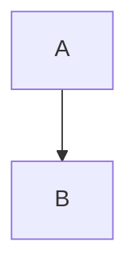

# H1
## H2
### H3
#### H4
##### H5
###### H6

**Bold** *Italic* ~~Strike~~ `code` [link](https://example.test)

<u>underline</u> ==highlight== H~2~O x^2^ :smile: <ruby>字<rt>zi</rt></ruby>

> [!NOTE]
> Golden alert

- One
1. Two
- [ ] Task

[TOC]

Footnote[^a]

[^a]: Text

$1+1$

$$
x^2
$$

